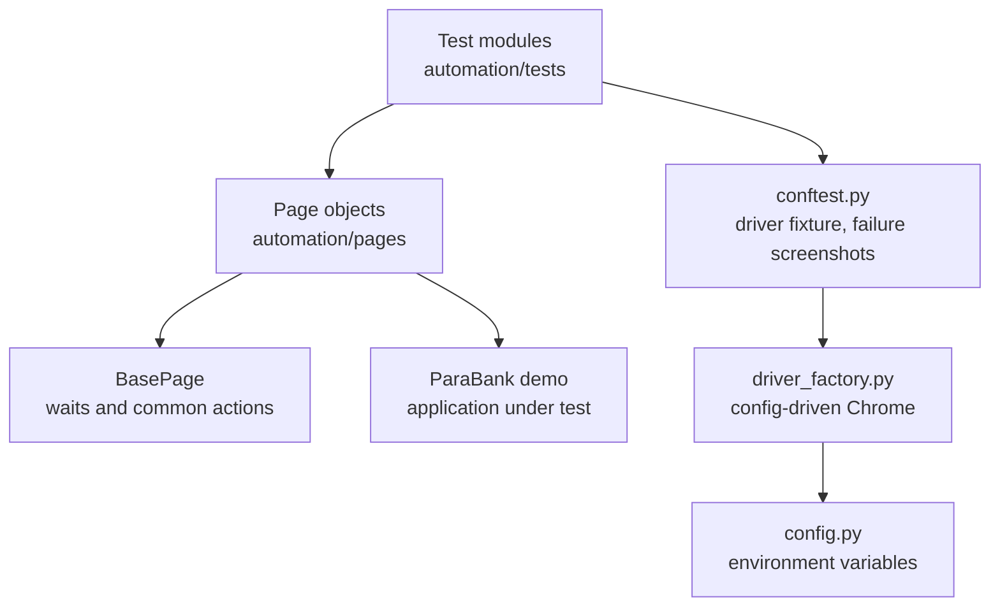

# Automation Guide — UI Test Automation

| Item | Detail |
|---|---|
| Document owner | Tegar |
| Version | 1.0 |
| Status | Active |
| Last updated | 2026-11-23 |
| Stack | Python 3.12, Selenium WebDriver, Pytest, Page Object Model |

## 1. Purpose

This guide explains how the UI automation suite in `automation/` is structured, configured, and executed, locally and in CI. It is the companion to the CI/CD documentation (`docs/ci-cd.md`).

## 2. Architecture

The suite follows the Page Object Model: tests contain assertions and test data only; all locators and page interactions live in page classes; browser creation and configuration are centralised in utilities.



## 3. Structure

| Path | Responsibility |
|---|---|
| `automation/pages/base_page.py` | Shared explicit waits and common element actions |
| `automation/pages/home_page.py` | Public homepage |
| `automation/pages/login_page.py` | Customer login form |
| `automation/pages/accounts_overview_page.py` | Account table, balances, open-account helper |
| `automation/pages/transfer_page.py` | Transfer Funds form and confirmation |
| `automation/tests/test_smoke.py` | HOME-TC-001 — homepage availability |
| `automation/tests/test_login.py` | AUTH-TC-001 (valid login), AUTH-TC-002 (invalid password, expected-fail against BUG-001) |
| `automation/tests/test_transfer.py` | TRF-TC-001 — transfer with exact balance-delta assertions |
| `automation/tests/conftest.py` | Driver lifecycle; screenshot captured automatically on failure |
| `automation/utils/config.py` | Environment-driven configuration |
| `automation/utils/driver_factory.py` | Chrome creation (headless support, CI-safe options) |

## 4. Configuration

Configuration is read from environment variables; no credentials are stored in code. The only account used is the published public demo account.

| Variable | Purpose | Default |
|---|---|---|
| `HEADLESS` | Run Chrome without a visible window (required in CI) | `false` locally |
| `PARABANK_BASE_URL` | Application base URL | ParaBank demo URL |
| `PARABANK_USERNAME` / `PARABANK_PASSWORD` | Demo account credentials | Published demo account |

See `.env.example` at the repository root for the full list.

## 5. Running the suite

```bash
pip install -r requirements.txt
pytest -m smoke            # the CI selection: smoke, login, transfer
pytest automation/tests/test_login.py   # a single module
HEADLESS=true pytest -m smoke           # headless, as in CI
```

Reports: pytest is configured (`pytest.ini`, strict markers) and CI adds a JUnit XML report and a self-contained HTML report (see `docs/ci-cd.md`).

## 6. Design rules

- **No hard-coded demo data.** ParaBank demo data resets without notice (RSK-101): tests read account IDs and balances at runtime and assert *changes* (exact deltas), never fixed values.
- **Explicit waits over sleeps.** The Accounts Overview table loads asynchronously; page objects wait for rows to appear.
- **Self-sufficient setup.** If the demo login holds only one account, the transfer test opens a second account through the UI as part of its setup instead of failing.
- **Known defects stay visible.** AUTH-TC-002 is marked `xfail` with a reference to BUG-001: the suite stays green while the defect is open, and the test starts failing loudly (xpass) if the application behaviour changes.

## 7. References

- CI/CD Documentation — `docs/ci-cd.md`
- Troubleshooting Guide — `docs/troubleshooting.md`
- Test Environment — `docs/test-environment.md`
- Workbook automation evidence: EXEC-003, EXEC-004, EXEC-009 — `test-cases.xlsx`
