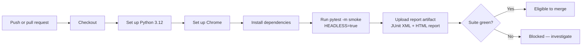

# CI/CD Documentation

| Item | Detail |
|---|---|
| Document owner | Tegar |
| Version | 1.0 |
| Status | Active |
| Last updated | 2026-11-23 |
| Pipeline | GitHub Actions (`.github/workflows/`), Jenkinsfile provided as an alternative |

## 1. Purpose

Every change to this repository is verified by an automated pipeline that runs the UI test suite against the ParaBank public demo. A change is merged only when the pipeline is green. This document describes the pipeline, its outputs, and the merge policy.

## 2. Pipeline

## 3. Triggers and steps

The workflow `QA Smoke Tests` runs on: pushes to `main`, every pull request, and manual dispatch (`workflow_dispatch`).

| Step | Detail |
|---|---|
| Checkout | `actions/checkout@v4` |
| Python | `actions/setup-python@v5`, Python 3.12 |
| Browser | `browser-actions/setup-chrome@v1` |
| Dependencies | `pip install -r requirements.txt` |
| Test run | `pytest -m smoke` with `HEADLESS=true`; JUnit XML and a self-contained HTML report are written to `reports/` |
| Artifacts | `actions/upload-artifact@v4` uploads `reports/` as `qa-smoke-report` on every run (`if: always()`), including failures |

## 4. Merge policy

- Work is developed on a `qa/*` branch and integrated through a pull request.
- The pull-request pipeline must be green before merging; the post-merge `main` run must also be green.
- A red pipeline is investigated before any further change. The suite's one expected-failure is AUTH-TC-002, marked `xfail` against the open defect BUG-001; it does not fail the build.

## 5. Evidence

Pipeline history is visible in the repository's GitHub Actions tab. Notable runs: the Phase 4 pull request run `45086175533` (first green run including the automated transfer test, recorded as EXEC-009 in `test-cases.xlsx`) and the post-merge `main` runs for each phase, all successful.

## 6. Jenkins

A `Jenkinsfile` at the repository root mirrors the same stages (checkout, install, headless test run) for environments that use Jenkins instead of GitHub Actions. GitHub Actions is the reference pipeline for this portfolio; the Jenkinsfile is provided, not executed as part of the recorded evidence.

## 7. References

- Automation Guide — `docs/automation-guide.md`
- Troubleshooting Guide — `docs/troubleshooting.md`
